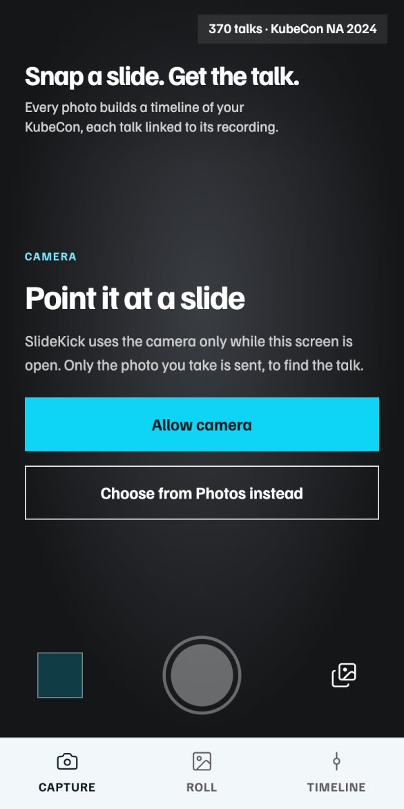
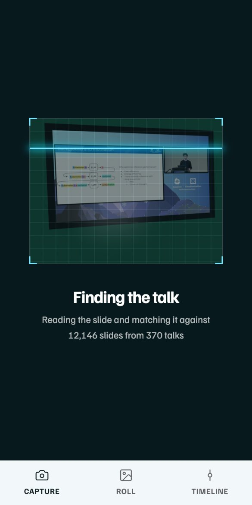
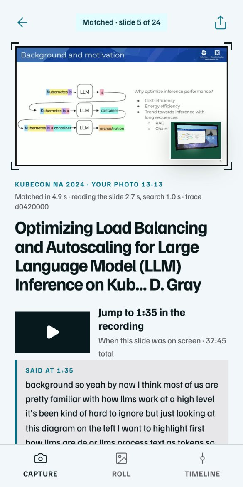
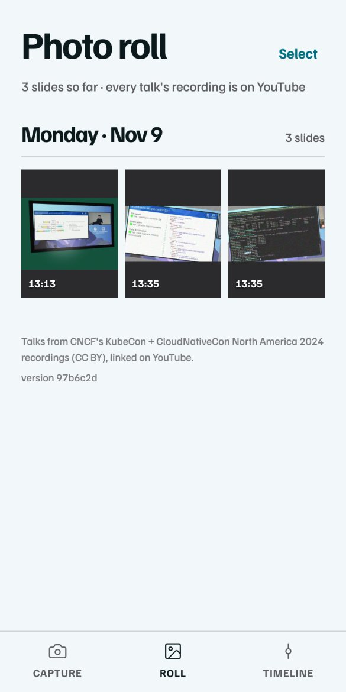
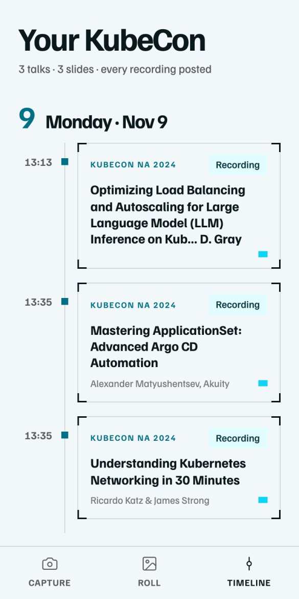
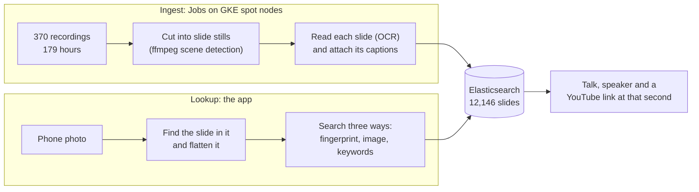

# SlideKick

Photograph a KubeCon slide and get the talk, the speaker and a YouTube link that starts the moment that slide appeared. Every photo you take builds a timeline of your conference.

Built in one day at the [Cloud Native Hackathon](https://www.wemakedevs.org/hackathons/cnh), Salt Lake City, November 9, 2026. Live at **https://slidekick.us**: open it on a phone.

| 1. Capture | 2. Finding the talk | 3. The match | 4. Your roll | 5. Your timeline |
| :---: | :---: | :---: | :---: | :---: |
|  |  |  |  |  |
| Point the camera at a slide, or choose photos. | The photo is matched against 12,146 slides from 370 talks. | The talk, the speaker, what was being said, and a link to that second. | Your photos, kept on your phone. | Each talk you saw, in order. |

Screenshots of the live site on November 9, from three test photos. All three matched the right talk and slide.

## Big wins

- **It finds the talk and the second.** From a photo of a laptop playing a talk, the right talk comes first 92% of the time. Across every kind of photo we tested, including off a projector, it's 74.5%, and 83.5% in the top three, up from 58% at midday ([results](docs/results.md)).
- **179 hours of video became 12,146 searchable slides in 25 minutes,** on 96 pods and 256 spot vCPUs of our GKE cluster.
- **One photo, three kinds of search.** Elasticsearch merges image similarity, keywords and a pixel fingerprint, and keeps answering when the embedding service is rate-limited.
- **A whole product in a day:** capture, match, photo roll and a timeline of your conference, live at https://slidekick.us.
- **The sponsor tools earned their place.** Gitar reviewed every PR and we fixed 15 of its findings before merging. Dash0's Agent0 found a silent tracing outage and opened the fix itself. Radar's AI investigation found a 95-second cold start on new spot nodes.

## How it works

**Ingest.** One pod per talk finds the slide area, detects each slide change with ffmpeg, keeps one still per slide, reads it with OCR, and attaches the captions spoken while it was up. All 370 KubeCon NA 2024 talks are in ([`ingest/`](ingest/README.md)).

**Lookup.** The app finds the slide inside your photo and flattens it, then searches it three ways in Elasticsearch: a pixel fingerprint, image similarity from Jina embeddings, and keywords on the slide text and captions, merged with reciprocal rank fusion. The hits are grouped by talk and linked to the second that slide came on screen ([`docs/search.md`](docs/search.md)).

**This week's talks.** The same index is designed for a conference that is still happening: with no recordings yet, a photo matches the speaker's posted deck and the sessions running at that time, then resolves to the exact second when the recording is published. Only 2024 data is loaded today.

## Built with

| Tool | What it does here | What it did for us |
| --- | --- | --- |
| **Elasticsearch** | The only data store: slides, embeddings, fingerprints, schedule | Hybrid search took the right-talk rate from 58% to 74.5% in an afternoon |
| **Gitar** | Reviews every PR against [our rules](.gitar/review/main.md) | 15 findings fixed before merging; one fix pushed by auto-apply |
| **Dash0** | Traces, metrics and logs for the app and the ingest Jobs | Agent0 found why traces had stopped and opened the fix ([#21](https://github.com/Naterd/hackathon-cnh/pull/21)) |
| **Radar** | Watches and operates the GKE cluster | Its AI investigation explained a stuck ingest Job; Checks went from 6 findings to 1 |
| **GKE and Argo CD** | Runs the app and the ingest; every merge deploys | Argo CD syncs each new image within about 3 minutes |

The full stories, with links and evidence, are in [`docs/details.md`](docs/details.md#sponsor-tools) and [`STORY.md`](STORY.md).

## Run it

- **Use it:** open https://slidekick.us on a phone and photograph a KubeCon NA 2024 talk playing full screen.
- **Run the app locally:** in `app/`, `pip install -r requirements.txt`, then `uvicorn main:app --reload --port 8080`. It needs `ELASTIC_URL` and `ELASTIC_ES_API_KEY`.
- **Deploy:** merge to `main`. A GitHub Action builds the image and Argo CD syncs it to GKE.
- **Set it up from scratch, and how we work in this repo:** [`docs/details.md`](docs/details.md#setup-from-scratch).

## Data and credits

- Talk recordings: CNCF's KubeCon + CloudNativeCon North America 2024 playlist on YouTube, licensed CC BY. We link to YouTube rather than re-hosting video.
- This week's schedule and decks come from the official KubeCon NA 2026 schedule. Decks are linked, not re-hosted.
- Deploy scaffolding: [skyhook-io/cnh-starter](https://github.com/skyhook-io/cnh-starter).

## AI assistance

We built this with AI coding assistants (Claude Code), as the hackathon rules allow and require us to disclose. The team reviewed and understands the code we submit.
